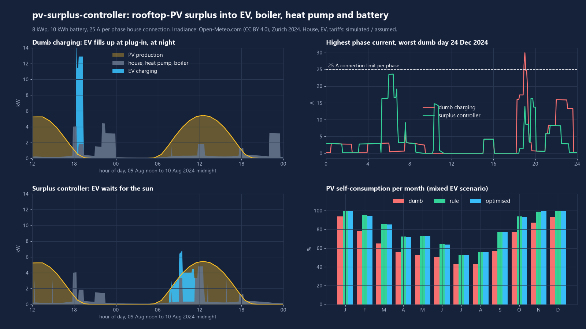
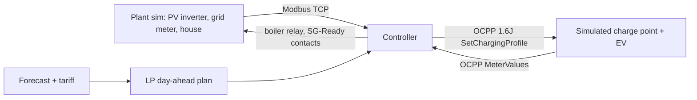

# pv-surplus-controller

Open-source home energy manager: it sends rooftop-PV surplus to an EV charger, a heat pump, a boiler and a battery, and keeps the house connection under its current limit. Real protocols (OCPP 1.6J, Modbus TCP), simulated devices.



## What it does

- **EV charging over OCPP 1.6J.** The controller is the central system (websocket). It sets the charging current and the number of phases with `SetChargingProfile` (TxProfile, amps, `numberPhases`). A simulated charge point obeys it and reports `MeterValues`.
- **Inverter and meter over Modbus TCP.** A simulated 3-phase inverter and grid meter expose a SunSpec-style register map (models 103 and 203, subset; see the docstring in `pvsc/sunspec.py`). The controller reads PV power and the per-phase grid current.
- **Heat pump** gets an SG-Ready style signal (two contacts, state 2 normal, state 3 recommended) that raises the room setpoint by 1 K when there is surplus. **Boiler** is a relay with a comfort floor (48 C) and a ceiling (62 C).
- **Rule-based surplus charging:** start/stop thresholds with hysteresis and minimum run time, 6 to 16 A, 1-phase to 3-phase switching with a dwell time, and a deadline fallback (if the surplus cannot finish the job, it charges from the grid at the latest possible time).
- **Connection limit:** per-phase current limit (default 25 A, 1 A margin). It sheds the boiler first, then lowers the EV current or falls back to 1 phase, and stops the EV if there is no headroom.
- **Optimised plan:** a linear programme (scipy/HiGHS) over hourly slots until departure, using a PV forecast, a typical base load and the tariff. Re-planned every 3 hours.
- **Metrics:** self-consumption, CHF against dumb charging, EV energy by departure, grid peak, relay and phase switches, steps above the limit.

## Results

One simulated year (2024, 5-minute steps, 8 kWp, 10 kWh battery, 25 A per phase). EV scenario "mixed": commute Mon/Tue/Thu, Wed/Fri 60 % home office, weekend errands; 264 plug-in sessions, 3.2 MWh. Purchase tariff 24.05 Rp/kWh (ElCom), feed-in 8 Rp/kWh (assumed). All numbers come from `python -m pvsc demo` (`results/summary.md`, `results/metrics.json`).

| Metric (year) | dumb | rule-based | optimised |
|---|---|---|---|
| PV self-consumption | 60.1 % | **75.0 %** | 74.8 % |
| Cost (CHF/a) | 1589.62 | 1375.20 | 1377.95 |
| CHF saved vs dumb | 0 | **214.42** | 211.67 |
| EV energy delivered by departure | 100 % | 100 % | 100 % |
| Grid peak, 15-min mean | 18.1 kW | 13.4 kW | 15.7 kW |
| Highest phase current | 29.9 A | 24.0 A | 23.9 A |
| 5-min steps above 25 A | 40 | **0** | **0** |
| Relay + phase switches (EV / boiler / SG signal) | 1260 (528 / 732 / 0) | 3934 (740 / 2154 / 1040) | 4368 (1192 / 2106 / 1070) |

"Dumb" = EV at full power from plug-in, boiler on a night timer, no heat-pump signal. All three strategies share the same battery rule (charge from surplus, discharge for the house but not into the EV), so the gain comes from scheduling. The price of the gain is about 3 times more relay operations.

Seasons (mixed, rule-based vs dumb): self-consumption winter 98 vs 88 %, spring 76 vs 57 %, summer 57 vs 45 %, autumn 88 vs 72 %; CHF saved 25 / 79 / 63 / 48. Dumb charging crossed 25 A on 28 steps in winter, 2 in spring, 10 in autumn.

Other scenarios and tariffs (CHF saved per year vs dumb, rule-based / optimised):

| Case | rule-based | optimised |
|---|---|---|
| commuter every weekday | 187.75 | 188.57 |
| home office | 208.10 | 200.01 |
| feed-in 4 Rp/kWh | 266.42 | 262.96 |
| feed-in 12 Rp/kWh | 162.42 | 160.37 |
| two-rate tariff (illustrative: 27 Rp high, 19 Rp low, assumed) | 210.49 | **276.26** |

Honest reading: with one flat purchase price the LP plan adds nothing over the rule (it is slightly worse, the forecast is about 10 % low against the reanalysis). It pays only when the price varies over the day.

Closed loop over real protocols (`python -m pvsc demo-live`, one virtual day, simulated devices):

| Run | Result |
|---|---|
| Sunny summer day (29 Jul 2024), 14 kWh need | 14.0 kWh delivered, 12 OCPP profiles sent and accepted, peak 11.5 A |
| Winter evening (10 Dec 2024), 25 kWh need, load burst 17:30 to 19:30 | 25.0 kWh delivered, settled peak 23.7 A (limit 25 A, 0 steps above), 30.5 A would occur uncontrolled, 6 steps limited by the controller |

## Quick start

```bash
python -m venv .venv && . .venv/bin/activate        # Windows: .venv\Scripts\activate
pip install -e ".[dev]"
python -m pvsc demo          # about 2.5 minutes: 12 year simulations, writes results/ and docs/ figures
python -m pvsc demo-live     # about 15 s: OCPP + Modbus TCP closed loop on localhost
python -m pvsc demo-live --limit-demo   # winter evening that stresses the 25 A limit
pytest -q && ruff check .
```

Three containers (controller, simulated charge point, simulated inverter and meter), one virtual day, results in `./results`:

```bash
docker compose up --build
```

The same three roles run as separate processes (`python -m pvsc inverter|charger|controller`, see `--help`); I ran them that way on one machine in any start order. The compose file itself is untested (no container daemon on my machine). Grafana is not included.

## How it works



- `pvsc/control.py`: pure decision logic, no I/O; the year simulation and the live loop call the same code.
- `pvsc/sim.py`: 5-minute year simulation (thermal model of the house, hot-water tank, battery, EV sessions).
- `pvsc/plan.py`: LP plan. `pvsc/sunspec.py`, `pvsc/ocpp_cs.py`, `pvsc/ocpp_cp.py`: protocol side. `pvsc/live.py`: closed loop.
- Live loop per 5 virtual minutes, two passes: the plant publishes a provisional meter reading (a load step just arrived), the controller reacts over OCPP and Modbus, the plant publishes the settled reading. The provisional peak is reported separately from the settled one.
- PV: `P = kWp * G_poa/1000 * (1 - 0.0035 (T_cell - 25)) * 0.80`, clipped at the 8 kW inverter, `T_cell = T_air + 0.03 G`.

## Data sources

- **Irradiance and temperature:** Open-Meteo Historical Weather API (observed, reanalysis based) and Historical Forecast API (archived model forecasts, used as the day-ahead forecast), Zurich 47.3769 N 8.5417 E, 1 Jan to 31 Dec 2024, plane of array 30 degrees tilt facing south. Weather data by Open-Meteo.com, licence CC BY 4.0. Cached in `data/`; refresh with `python scripts/fetch_data.py`.
- **Purchase tariff:** ElCom electricity price dataset 2024 ("Strompreis pro Stromnetzbetreiber", opendata.swiss / LINDAS), category H4 (4500 kWh/a household), operator id 565 (the Zurich city utility), standard product, 24.054 Rp/kWh (energy 7.384, grid 12.27, levies 4.4). Source: ElCom.
- **Feed-in tariff:** 8 Rp/kWh is an assumed round number, not a utility quote. The two-rate tariff (27 / 19 Rp) is an invented illustration.
- **Household load, hot-water draw, EV sessions, driving:** simulated, seeded, in `pvsc/data.py`.

## What is not verified yet

- No real hardware. The inverter, meter, charge point, EV, heat pump and boiler are simulated; no third-party OCPP charge point or SunSpec device was tested. The register map is a documented subset, not a certified SunSpec implementation.
- The year simulation assumes the controller reacts inside the 5-minute step. The live loop models this with a two-pass step; a real load step larger than the margin lasts for the reaction time of the charger and the meter (seconds), which fuses tolerate but I did not test.
- PV yield (1088 kWh/kWp) comes from reanalysis irradiance and a simple model; not compared with a measured system. The forecast is about 10 % lower than the reanalysis over the year.
- Feed-in price is assumed; ElCom prices are, as far as I know, without VAT, not re-checked per dataset. One household, one location, one year, one seeded load and driving pattern.
- The heat pump is a one-zone thermal model with a generic COP curve. The SG-Ready contact mapping is the usual two-contact scheme; no device was connected.
- The planner uses a typical base load and ignores battery, heat pump and boiler.
- Docker compose not run on my machine.

## Licence

MIT, Copyright (c) 2026 VB-Builds. Dependencies: ocpp (MIT), pymodbus (BSD-3-Clause), websockets, scipy, numpy, pandas (BSD), matplotlib. Weather data CC BY 4.0 (Open-Meteo).
